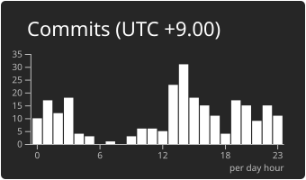

## My Portfolio Site is [here](https://artemit.dev/)!

<!--
**Artemol/Artemol** is a ✨ _special_ ✨ repository because its `README.md` (this file) appears on your GitHub profile.

Here are some ideas to get you started:

- 🔭 I’m currently working on ...
- 🌱 I’m currently learning ...
- 👯 I’m looking to collaborate on ...
- 🤔 I’m looking for help with ...
- 💬 Ask me about ...
- 📫 How to reach me: ...
- 😄 Pronouns: ...
- ⚡ Fun fact: ...
-->

## ⚡GitHub Stats
[](https://github.com/vn7n24fzkq/github-profile-summary-cards)
[](https://github.com/vn7n24fzkq/github-profile-summary-cards) [](https://github.com/vn7n24fzkq/github-profile-summary-cards)
[](https://github.com/vn7n24fzkq/github-profile-summary-cards) [](https://github.com/vn7n24fzkq/github-profile-summary-cards)

<!--
## 🌱 My Skills (Including Learnings)

### Languages
[](https://skillicons.dev)

### Editors
[](https://skillicons.dev)

### Frameworks
[](https://skillicons.dev)

### Tools
[](https://skillicons.dev)

### OS
[](https://skillicons.dev)

### Others
[](https://skillicons.dev)
-->

## 💬WakaTime Stats
<!--START_SECTION:waka-->


**I'm a Night 🦉** 

```text
🌞 Morning                495 commits         ██░░░░░░░░░░░░░░░░░░░░░░░   08.98 % 
🌆 Daytime                1939 commits        █████████░░░░░░░░░░░░░░░░   35.18 % 
🌃 Evening                1063 commits        █████░░░░░░░░░░░░░░░░░░░░   19.29 % 
🌙 Night                  2014 commits        █████████░░░░░░░░░░░░░░░░   36.55 % 
```
📅 **I'm Most Productive on Tuesday** 

```text
Monday                   885 commits         ████░░░░░░░░░░░░░░░░░░░░░   16.06 % 
Tuesday                  1135 commits        █████░░░░░░░░░░░░░░░░░░░░   20.60 % 
Wednesday                632 commits         ███░░░░░░░░░░░░░░░░░░░░░░   11.47 % 
Thursday                 652 commits         ███░░░░░░░░░░░░░░░░░░░░░░   11.83 % 
Friday                   680 commits         ███░░░░░░░░░░░░░░░░░░░░░░   12.34 % 
Saturday                 603 commits         ███░░░░░░░░░░░░░░░░░░░░░░   10.94 % 
Sunday                   924 commits         ████░░░░░░░░░░░░░░░░░░░░░   16.77 % 
```


📊 **This Week I Spent My Time On** 

```text
🕑︎ Time Zone: Asia/Tokyo

💬 Programming Languages: 
Markdown                 4 hrs 46 mins       █████████████░░░░░░░░░░░░   52.85 % 
Python                   2 hrs 46 mins       ████████░░░░░░░░░░░░░░░░░   30.71 % 
Text                     32 mins             ██░░░░░░░░░░░░░░░░░░░░░░░   06.09 % 
YAML                     25 mins             █░░░░░░░░░░░░░░░░░░░░░░░░   04.75 % 
HTML                     13 mins             █░░░░░░░░░░░░░░░░░░░░░░░░   02.55 % 

🔥 Editors: 
Claude Code              8 hrs 27 mins       ███████████████████████░░   93.74 % 
Codex Exec               26 mins             █░░░░░░░░░░░░░░░░░░░░░░░░   04.80 % 
Codex Vscode             7 mins              ░░░░░░░░░░░░░░░░░░░░░░░░░   01.40 % 
Codex CLI                0 secs              ░░░░░░░░░░░░░░░░░░░░░░░░░   00.06 % 

💻 Operating System: 
Linux                    9 hrs 1 min         █████████████████████████   100.00 % 
```

🤖 **AI Coding This Week** 

```text
⏱ AI Coding Time: 9 hrs 1 min (100.0%)

✍️ 12,489 lines written by AI, 0 lines written by hand (100.0% AI-written)

🔤 8,846,384 Input Tokens, 1,238,395 Output Tokens

💵 $112.93 Estimated AI Cost This Week

🧠 18 AI Sessions, 105 AI Prompts

Opus                     12,381 lines        █████████████████████████   98.99 % 
GPT                      126 lines           ░░░░░░░░░░░░░░░░░░░░░░░░░   01.01 % 
Fable                    0 lines             ░░░░░░░░░░░░░░░░░░░░░░░░░   00.00 % 

🔎 AI Coding Insights:
🤖 AI-Driven — 100.0% of written lines came from AI
📚 Verbose Prompter — average 2,934 characters per prompt
🔁 Iterative Prompter — average 6 prompts per session
🚀 High AI Trust — 0.0% of changed lines were hand-edited
```

**I Mostly Code in TypeScript** 

```text
Go                       6 repos             ██░░░░░░░░░░░░░░░░░░░░░░░   08.82 % 
Shell                    2 repos             █░░░░░░░░░░░░░░░░░░░░░░░░   02.94 % 
HTML                     2 repos             █░░░░░░░░░░░░░░░░░░░░░░░░   02.94 % 
Rust                     2 repos             █░░░░░░░░░░░░░░░░░░░░░░░░   02.94 % 
C++                      1 repo              ░░░░░░░░░░░░░░░░░░░░░░░░░   01.47 % 
```


 Last Updated on 19/11/2026 18:38:20 UTC
<!--END_SECTION:waka-->
