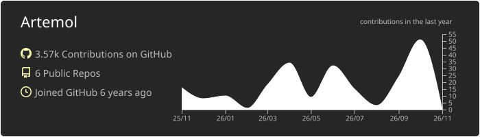
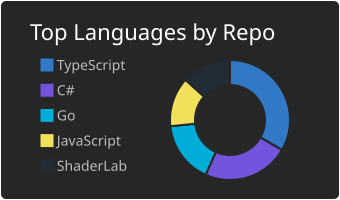
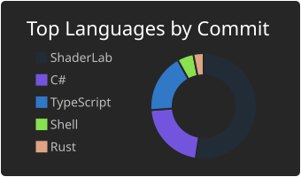
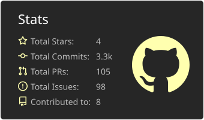
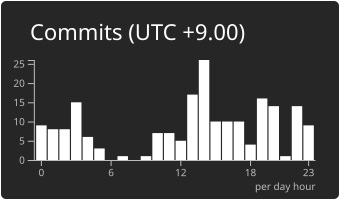

## My Portfolio Site is [here](https://artemit.dev/)!

<!--
**Artemol/Artemol** is a ✨ _special_ ✨ repository because its `README.md` (this file) appears on your GitHub profile.

Here are some ideas to get you started:

- 🔭 I’m currently working on ...
- 🌱 I’m currently learning ...
- 👯 I’m looking to collaborate on ...
- 🤔 I’m looking for help with ...
- 💬 Ask me about ...
- 📫 How to reach me: ...
- 😄 Pronouns: ...
- ⚡ Fun fact: ...
-->

## ⚡GitHub Stats
[](https://github.com/vn7n24fzkq/github-profile-summary-cards)
[](https://github.com/vn7n24fzkq/github-profile-summary-cards) [](https://github.com/vn7n24fzkq/github-profile-summary-cards)
[](https://github.com/vn7n24fzkq/github-profile-summary-cards) [](https://github.com/vn7n24fzkq/github-profile-summary-cards)

<!--
## 🌱 My Skills (Including Learnings)

### Languages
[](https://skillicons.dev)

### Editors
[](https://skillicons.dev)

### Frameworks
[](https://skillicons.dev)

### Tools
[](https://skillicons.dev)

### OS
[](https://skillicons.dev)

### Others
[](https://skillicons.dev)
-->

## 💬WakaTime Stats
<!--START_SECTION:waka-->


**I'm a Night 🦉** 

```text
🌞 Morning                365 commits         ██░░░░░░░░░░░░░░░░░░░░░░░   08.72 % 
🌆 Daytime                1504 commits        █████████░░░░░░░░░░░░░░░░   35.94 % 
🌃 Evening                837 commits         █████░░░░░░░░░░░░░░░░░░░░   20.00 % 
🌙 Night                  1479 commits        █████████░░░░░░░░░░░░░░░░   35.34 % 
```
📅 **I'm Most Productive on Tuesday** 

```text
Monday                   684 commits         ████░░░░░░░░░░░░░░░░░░░░░   16.34 % 
Tuesday                  1010 commits        ██████░░░░░░░░░░░░░░░░░░░   24.13 % 
Wednesday                471 commits         ███░░░░░░░░░░░░░░░░░░░░░░   11.25 % 
Thursday                 477 commits         ███░░░░░░░░░░░░░░░░░░░░░░   11.40 % 
Friday                   494 commits         ███░░░░░░░░░░░░░░░░░░░░░░   11.80 % 
Saturday                 352 commits         ██░░░░░░░░░░░░░░░░░░░░░░░   08.41 % 
Sunday                   697 commits         ████░░░░░░░░░░░░░░░░░░░░░   16.65 % 
```


📊 **This Week I Spent My Time On** 

```text
🕑︎ Time Zone: Asia/Tokyo

💬 Programming Languages: 
Python                   13 hrs 39 mins      ██████████████░░░░░░░░░░░   57.07 % 
Markdown                 5 hrs 51 mins       ██████░░░░░░░░░░░░░░░░░░░   24.50 % 
Other                    1 hr 21 mins        █░░░░░░░░░░░░░░░░░░░░░░░░   05.64 % 
Typst                    1 hr 12 mins        █░░░░░░░░░░░░░░░░░░░░░░░░   05.02 % 
Bash                     49 mins             █░░░░░░░░░░░░░░░░░░░░░░░░   03.44 % 

🔥 Editors: 
VS Code                  12 hrs 8 mins       █████████████░░░░░░░░░░░░   50.71 % 
Claude Code              11 hrs 12 mins      ████████████░░░░░░░░░░░░░   46.84 % 
Codex Exec               34 mins             █░░░░░░░░░░░░░░░░░░░░░░░░   02.40 % 
Codex CLI                0 secs              ░░░░░░░░░░░░░░░░░░░░░░░░░   00.04 % 

💻 Operating System: 
Windows                  10 hrs 57 mins      ███████████░░░░░░░░░░░░░░   45.80 % 
Linux                    10 hrs 1 min        ██████████░░░░░░░░░░░░░░░   41.91 % 
Mac                      2 hrs 56 mins       ███░░░░░░░░░░░░░░░░░░░░░░   12.29 % 
```

🤖 **AI Coding This Week** 

```text
⏱ AI Coding Time: 11 hrs 51 mins (49.55%)

✍️ 7,193 lines written by AI, 3,739 lines written by hand (65.8% AI-written)

🔤 14,791,302 Input Tokens, 1,925,180 Output Tokens

💵 $155.39 Estimated AI Cost This Week

🧠 33 AI Sessions, 134 AI Prompts

Opus                     7,032 lines         ████████████████████████░   97.65 % 
GPT                      169 lines           █░░░░░░░░░░░░░░░░░░░░░░░░   02.35 % 

🔎 AI Coding Insights:
⚖️ Balanced with AI — 65.8% of written lines came from AI
📚 Verbose Prompter — average 5,960 characters per prompt
🔁 Iterative Prompter — average 4 prompts per session
🚀 High AI Trust — 38.58% of changed lines were hand-edited
```

**I Mostly Code in TypeScript** 

```text
Go                       6 repos             ██░░░░░░░░░░░░░░░░░░░░░░░   08.96 % 
JavaScript               4 repos             █░░░░░░░░░░░░░░░░░░░░░░░░   05.97 % 
HTML                     2 repos             █░░░░░░░░░░░░░░░░░░░░░░░░   02.99 % 
Rust                     2 repos             █░░░░░░░░░░░░░░░░░░░░░░░░   02.99 % 
C++                      1 repo              ░░░░░░░░░░░░░░░░░░░░░░░░░   01.49 % 
```


 Last Updated on 09/11/2026 18:38:39 UTC
<!--END_SECTION:waka-->
