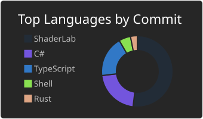
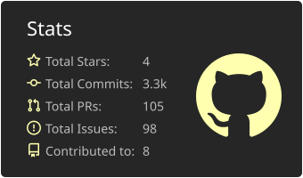

## My Portfolio Site is [here](https://artemit.dev/)!

<!--
**Artemol/Artemol** is a ✨ _special_ ✨ repository because its `README.md` (this file) appears on your GitHub profile.

Here are some ideas to get you started:

- 🔭 I’m currently working on ...
- 🌱 I’m currently learning ...
- 👯 I’m looking to collaborate on ...
- 🤔 I’m looking for help with ...
- 💬 Ask me about ...
- 📫 How to reach me: ...
- 😄 Pronouns: ...
- ⚡ Fun fact: ...
-->

## ⚡GitHub Stats
[](https://github.com/vn7n24fzkq/github-profile-summary-cards)
[](https://github.com/vn7n24fzkq/github-profile-summary-cards) [](https://github.com/vn7n24fzkq/github-profile-summary-cards)
[](https://github.com/vn7n24fzkq/github-profile-summary-cards) [](https://github.com/vn7n24fzkq/github-profile-summary-cards)

<!--
## 🌱 My Skills (Including Learnings)

### Languages
[](https://skillicons.dev)

### Editors
[](https://skillicons.dev)

### Frameworks
[](https://skillicons.dev)

### Tools
[](https://skillicons.dev)

### OS
[](https://skillicons.dev)

### Others
[](https://skillicons.dev)
-->

## 💬WakaTime Stats
<!--START_SECTION:waka-->


**I'm a Night 🦉** 

```text
🌞 Morning                579 commits         ██░░░░░░░░░░░░░░░░░░░░░░░   09.31 % 
🌆 Daytime                2175 commits        █████████░░░░░░░░░░░░░░░░   34.98 % 
🌃 Evening                1187 commits        █████░░░░░░░░░░░░░░░░░░░░   19.09 % 
🌙 Night                  2276 commits        █████████░░░░░░░░░░░░░░░░   36.61 % 
```
📅 **I'm Most Productive on Tuesday** 

```text
Monday                   987 commits         ████░░░░░░░░░░░░░░░░░░░░░   15.88 % 
Tuesday                  1203 commits        █████░░░░░░░░░░░░░░░░░░░░   19.35 % 
Wednesday                738 commits         ███░░░░░░░░░░░░░░░░░░░░░░   11.87 % 
Thursday                 766 commits         ███░░░░░░░░░░░░░░░░░░░░░░   12.32 % 
Friday                   800 commits         ███░░░░░░░░░░░░░░░░░░░░░░   12.87 % 
Saturday                 681 commits         ███░░░░░░░░░░░░░░░░░░░░░░   10.95 % 
Sunday                   1042 commits        ████░░░░░░░░░░░░░░░░░░░░░   16.76 % 
```


📊 **This Week I Spent My Time On** 

```text
🕑︎ Time Zone: Asia/Tokyo

💬 Programming Languages: 
Markdown                 7 hrs 10 mins       ████████████████████░░░░░   79.00 % 
Python                   52 mins             ██░░░░░░░░░░░░░░░░░░░░░░░   09.71 % 
JSON                     17 mins             █░░░░░░░░░░░░░░░░░░░░░░░░   03.22 % 
Bash                     14 mins             █░░░░░░░░░░░░░░░░░░░░░░░░   02.69 % 
HTML                     13 mins             █░░░░░░░░░░░░░░░░░░░░░░░░   02.51 % 

🔥 Editors: 
Claude Code              9 hrs 5 mins        █████████████████████████   100.00 % 

💻 Operating System: 
Linux                    8 hrs 34 mins       ████████████████████████░   94.42 % 
Mac                      30 mins             █░░░░░░░░░░░░░░░░░░░░░░░░   05.58 % 
```

🤖 **AI Coding This Week** 

```text
⏱ AI Coding Time: 9 hrs 5 mins (100.0%)

✍️ 15,833 lines written by AI, 0 lines written by hand (100.0% AI-written)

🔤 7,851,084 Input Tokens, 1,256,529 Output Tokens

💵 $97.63 Estimated AI Cost This Week

🧠 12 AI Sessions, 105 AI Prompts

Opus                     15,856 lines        █████████████████████████   100.00 % 
Fable                    0 lines             ░░░░░░░░░░░░░░░░░░░░░░░░░   00.00 % 

🔎 AI Coding Insights:
🤖 AI-Driven — 100.0% of written lines came from AI
📚 Verbose Prompter — average 3,121 characters per prompt
🔁 Iterative Prompter — average 9 prompts per session
🚀 High AI Trust — 0.0% of changed lines were hand-edited
```

**I Mostly Code in TypeScript** 

```text
Go                       6 repos             ██░░░░░░░░░░░░░░░░░░░░░░░   08.82 % 
Shell                    2 repos             █░░░░░░░░░░░░░░░░░░░░░░░░   02.94 % 
HTML                     2 repos             █░░░░░░░░░░░░░░░░░░░░░░░░   02.94 % 
Rust                     2 repos             █░░░░░░░░░░░░░░░░░░░░░░░░   02.94 % 
C++                      1 repo              ░░░░░░░░░░░░░░░░░░░░░░░░░   01.47 % 
```


 Last Updated on 21/11/2026 18:37:46 UTC
<!--END_SECTION:waka-->
